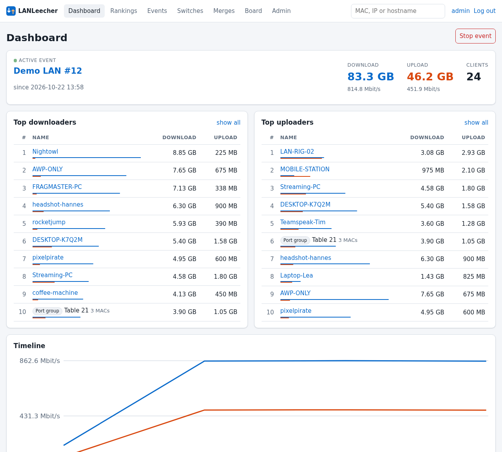
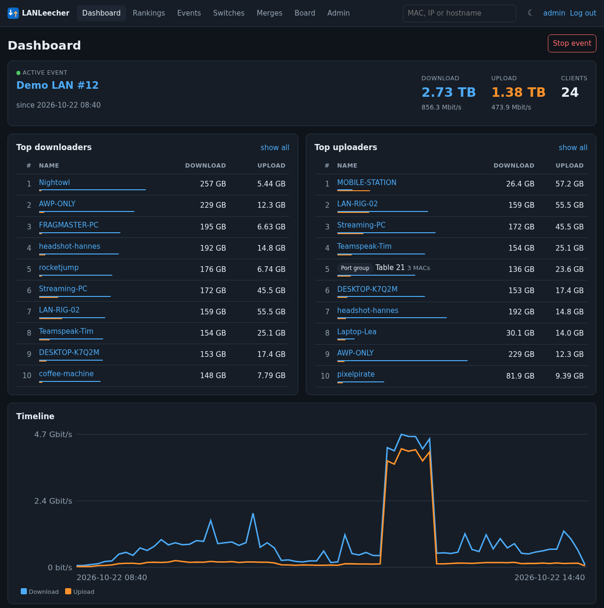
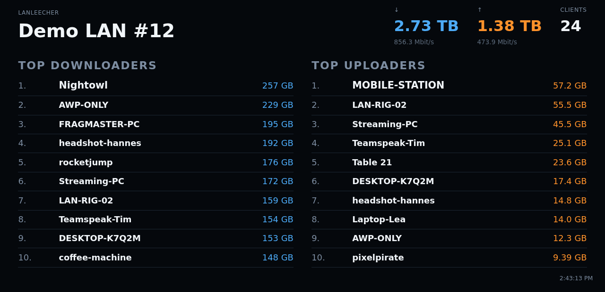
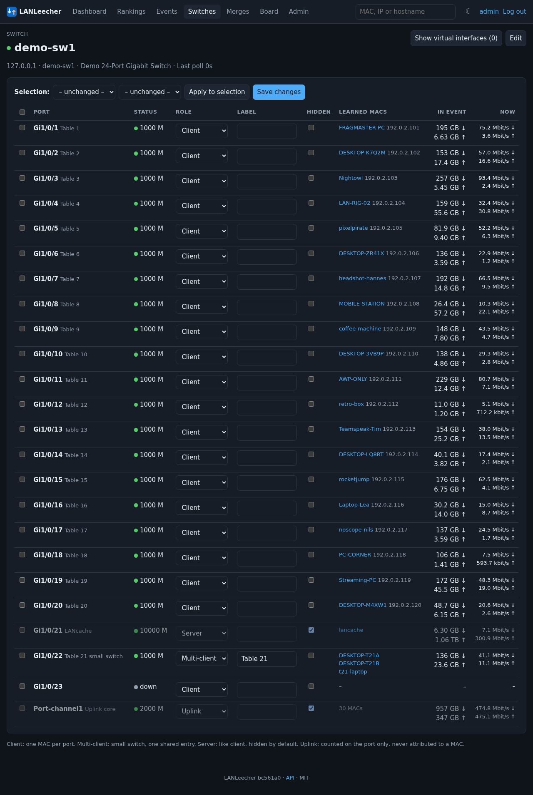

# LANLeecher

**Who's pulling the most?** At LAN parties, LANLeecher counts how much every guest downloads and
uploads and turns it into rankings – in the browser, on the beamer and via API. The data comes
straight from the switches via SNMP; nothing has to be installed on the guests' computers.

> **Status: pre-release.** Polling via SNMP v2c/v3, accounting per MAC and event, uplink detection,
> IP and hostname discovery (Kea DHCP, ARP, NetBIOS, mDNS, LLMNR, DNS), web UI in English and German,
> beamer view, REST API, packages and Docker image. Tested with TP-Link Omada and JetStream switches, and with a Grandstream GWN7721 (port traffic only).
> Next up: the first real LAN party. Progress is tracked in [docs/ROADMAP.md](docs/ROADMAP.md).







## What LANLeecher does

- **Rankings per event:** top downloaders and uploaders, totals, live throughput, timeline;
  top 10/20/50, per switch or time range, and across all LAN parties.
- **History per device:** download and upload of every machine at every event, with its IP and
  hostname history and the ports it was seen on.
- **Beamer view** `/board` with live updates, and the same data via API for Discord bots and
  other tools.
- **Switch and port management** with a connection test, port roles (client, multi-client, server,
  uplink), labels, and hints for ports that look like uplinks (LLDP neighbor, many MACs).
- **Network map** with your switches and internet connections on a floor plan, links from LLDP and
  MAC tables, and live traffic colours – see [docs/map.md](docs/map.md).
- **Host agent** for Linux and Proxmox VE (`lanleecher-agent` package): splits hypervisor ports
  between their guests – the switch stays authoritative, see [docs/agent.md](docs/agent.md).
- **Internet connections:** named WAN links (e.g. fibre and an LTE backup) with their own traffic,
  charts and utilisation tiles, reported separately – see [docs/wan.md](docs/wan.md).
- **Export and import** of switches, devices and events with their traffic into another instance
  (without credentials) – see [docs/export-import.md](docs/export-import.md).
- **Hostnames from Kea DHCP** (Kea 2.x and 3.x, read-only, certificate pinning) and from the
  network itself (NetBIOS, mDNS, LLMNR, DNS), with history per device; vendor names from the IEEE
  registry for MAC addresses.
- **Hiding** of game servers, caches and uplinks from rankings – they are still counted, and hiding
  applies retroactively.
- **Events** to start and stop, compare and export as CSV or JSON – or plan them with a date range
  so they start and stop by themselves.
- **Accounts** with three roles (viewer, operator, admin), API tokens with scopes, and an audit log.
- **Light and dark theme**, following the system or chosen per user; English and German.
- **Packages** for Debian/Ubuntu, Fedora/RHEL, Arch Linux and Alpine, and a multi-arch Docker image.



## Design principles

- **Counters from the switches, nothing on the clients.** LANLeecher reads 64-bit interface
  counters and the forwarding table via SNMP. The MAC address is the key; IP and hostname are
  extra information with history.
- **Only deltas are stored.** A total is the sum of the deltas between two polls, so a switch reboot,
  a counter reset or a LANLeecher restart never reduces it ([ADR 0002](docs/adr/0002-store-deltas-only.md)).
- **Every port is counted, hiding happens at query time.** Uplinks are counted on the port but never
  credited to a guest; servers and caches can be hidden without losing data.
- **A single binary.** Go, built-in SQLite, everything embedded – runs on a Raspberry Pi without
  internet access.
- **Secure by default.** Everything requires a login, SNMP credentials are encrypted, names from the
  network are treated as untrusted. See [SECURITY.md](SECURITY.md).

## Switch support

| Switch | SNMP | State |
| --- | --- | --- |
| Any switch with IF-MIB 64-bit counters and BRIDGE-MIB or Q-BRIDGE-MIB | v2c, v3 | **supported** |
| TP-Link Omada (10-port PoE+, 8× 2.5G + 2× 10G), JetStream T1500G-8T | v2c | **tested** ([notes](docs/switch-compatibility.md#tested-models)) |
| Grandstream GWN7721 | v2c | **tested, port traffic only** – no MAC table over SNMP ([notes](docs/switch-compatibility.md#tested-models)) |
| Cisco IOS (FDB per VLAN via `community@vlan`) | v2c, v3 | adapter available, untested |
| Switches with SNMP v1 only | v1 | not supported ([why](docs/adr/0003-no-snmp-v1.md)) |

## Quick start

### From the lan.party package repository (recommended)

Set up the repository once, then install and update the package with your system's package manager.
Instructions for Debian/Ubuntu, Fedora/RHEL/Rocky, Arch Linux and Alpine: **https://repo.lan.party**

```sh
curl -fsSL https://repo.lan.party/setup.sh | sudo sh   # or follow the manual steps on repo.lan.party

sudo apt install lanleecher      # Debian / Ubuntu
sudo dnf install lanleecher      # Fedora / RHEL / Rocky
sudo pacman -S lanleecher        # Arch Linux
sudo apk add lanleecher          # Alpine
```

New releases then arrive with your normal system updates (`apt upgrade`, `dnf upgrade`, `pacman -Syu`, `apk upgrade`).

### Manual download from GitHub releases

Download the package for your system from the [releases](https://github.com/lan-dot-party/LANLeecher/releases):

```bash
sudo apt install ./lanleecher_<version>_amd64.deb
sudo nano /etc/lanleecher/config.yaml           # listen, public_url
sudo lanleecher user create admin --role admin
sudo systemctl enable --now lanleecher
```

Then log in, add your switches under **Switches**, mark the uplinks and start the event. The
[LAN party guide](docs/lan-party-guide.md) walks through it.

### Docker Compose

Two ready-made examples in the repository root, both with the multi-arch image
`ghcr.io/lan-dot-party/lanleecher`:

| File | Persistent data | When to use |
|---|---|---|
| [`compose.yaml`](compose.yaml) | named Docker volume `lanleecher-data` | simplest; Docker manages the data |
| [`compose.bind.yaml`](compose.bind.yaml) | local directory `./data` | data visible on the host, easy to back up; the directory must belong to UID `100` / GID `101` (the container user) |

Both examples use host networking: the name resolvers need NetBIOS/mDNS and the host's
neighbor table. LANLeecher then listens on port 9040 of the host. To set `public_url` or the
listen address, mount your own `config.yaml` (commented line in the files).

With a named volume:

```bash
curl -fsSLO https://raw.githubusercontent.com/lan-dot-party/LANLeecher/main/compose.yaml
docker compose up -d
docker compose exec lanleecher lanleecher user create admin --role admin
```

With a local directory:

```bash
curl -fsSLO https://raw.githubusercontent.com/lan-dot-party/LANLeecher/main/compose.bind.yaml
mkdir -p data && sudo chown 100:101 data
docker compose -f compose.bind.yaml up -d
docker compose -f compose.bind.yaml exec lanleecher lanleecher user create admin --role admin
```

Update with `docker compose pull && docker compose up -d` (add `-f compose.bind.yaml` for the
second variant). Backup, reverse proxy and details:
[docs/installation.md](docs/installation.md#docker-compose).

## Documentation

- [docs/lan-party-guide.md](docs/lan-party-guide.md) – checklist for organizers: before, during and after the event
- [docs/installation.md](docs/installation.md) – packages, Docker, command line, backup, upgrade
- [docs/configuration.md](docs/configuration.md) – every setting (generated from the source), with a [JSON Schema](docs/config.schema.json)
- [docs/reverse-proxy.md](docs/reverse-proxy.md) – nginx, Caddy, Traefik, or none
- [docs/switch-compatibility.md](docs/switch-compatibility.md) – required MIBs, FDB adapters, tested models
- [docs/kea.md](docs/kea.md) – Kea DHCP 2.x and 3.x: configuration, certificates, troubleshooting
- [docs/concepts.md](docs/concepts.md) – events, devices, port groups, roles, hiding, directions
- [docs/export-import.md](docs/export-import.md) – move recordings to another instance
- [docs/wan.md](docs/wan.md) – internet connections (WAN links): ports, bandwidth, API
- [docs/map.md](docs/map.md) – network map: background image, links from LLDP and MAC tables, live traffic
- [docs/agent.md](docs/agent.md) – host agent for Linux and Proxmox VE: install, encryption, what it reports
- [docs/api.md](docs/api.md) – authentication, scopes, endpoints, errors, metrics
- [examples/](examples/) – Discord bot, Grafana, Go and shell clients
- [docs/architecture.md](docs/architecture.md) – how LANLeecher is built
- [docs/security.md](docs/security.md) – threat model and residual risks
- [docs/adapters.md](docs/adapters.md) – supporting a new switch or name source
- [docs/adr/](docs/adr/) – architecture decision records
- [docs/ROADMAP.md](docs/ROADMAP.md) – status and next steps
- [llms.txt](llms.txt) and [docs/llms-full.txt](docs/llms-full.txt) – the documentation for LLMs
- [CONTRIBUTING.md](CONTRIBUTING.md) – development setup and contribution rules
- [SECURITY.md](SECURITY.md) – reporting vulnerabilities

## Development quick start

Requires Go 1.26 or newer; Python 3 only for the SNMP simulator used in tests.

```bash
git clone https://github.com/lan-dot-party/LANLeecher.git
cd LANLeecher
python3 -m venv .venv && .venv/bin/pip install snmpsim pysmi
go test ./...
```

[CONTRIBUTING.md](CONTRIBUTING.md) shows how to run LANLeecher against a simulated 24-port switch.

## Related projects

- [LANPilot](https://github.com/lan-dot-party/LANPilot) – monitor and control game servers at LAN parties.
- [FlowGauge](https://github.com/lan-dot-party/flowgauge) – bandwidth monitoring with multi-WAN support.
- [Discord-Gameserver-Notifier](https://github.com/lan-dot-party/Discord-Gameserver-Notifier) –
  discovers game servers on the LAN and announces them on Discord.

## License

[MIT](LICENSE). MAC vendor names come from the public IEEE Registration Authority listings
(MA-L, MA-M, MA-S), refreshed with `tools/genoui`.
